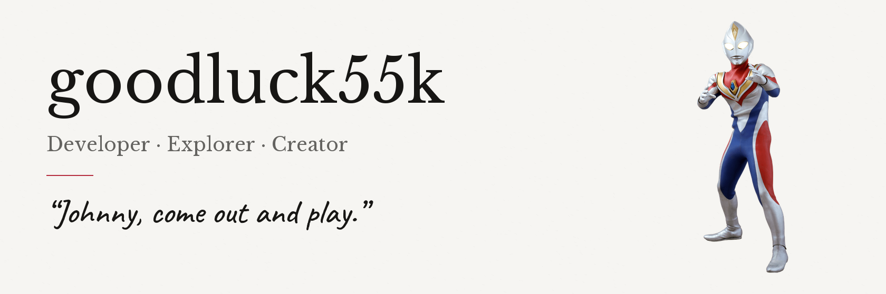
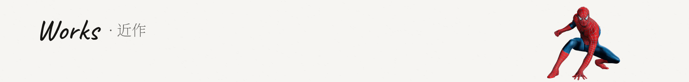
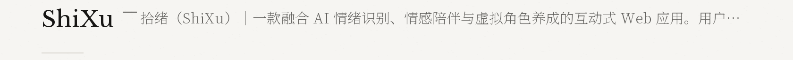
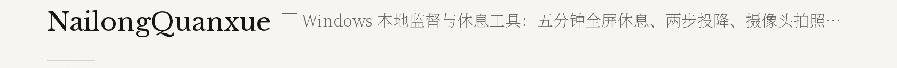
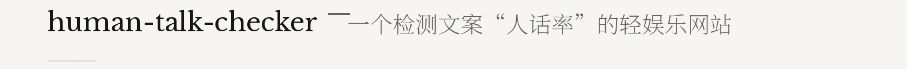
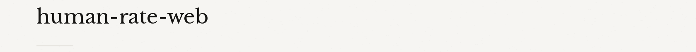
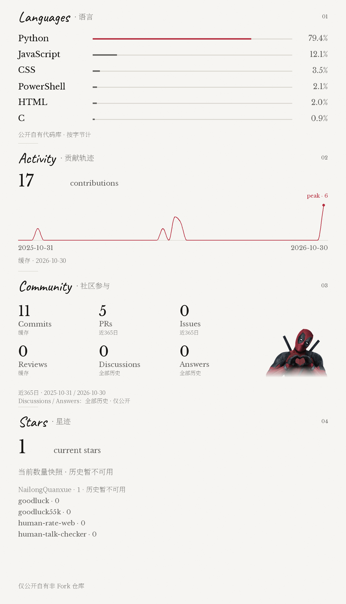
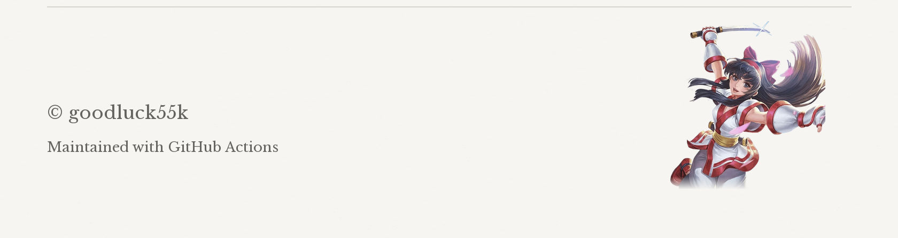

<!-- Generated by scripts/build.py from config/profile.json and the assets/data caches; works are auto-discovered by scripts/collect.py. -->

<picture>
  <source media="(prefers-color-scheme: dark) and (max-width: 440px)" srcset="assets/static/header-dark-mobile.png">
  <source media="(max-width: 440px)" srcset="assets/static/header-light-mobile.png">
  <source media="(prefers-color-scheme: dark)" srcset="assets/static/header-dark.png">
  
</picture>

<picture>
  <source media="(prefers-color-scheme: dark) and (max-width: 440px)" srcset="assets/static/works-heading-dark-mobile.png">
  <source media="(max-width: 440px)" srcset="assets/static/works-heading-light-mobile.png">
  <source media="(prefers-color-scheme: dark)" srcset="assets/static/works-heading-dark.png">
  
</picture>

<a href="https://github.com/goodluck55k/ShiXu"><picture>
  <source media="(prefers-color-scheme: dark) and (max-width: 440px)" srcset="assets/static/work-1-dark-mobile.png">
  <source media="(max-width: 440px)" srcset="assets/static/work-1-light-mobile.png">
  <source media="(prefers-color-scheme: dark)" srcset="assets/static/work-1-dark.png">
  
</picture></a> 
<a href="https://github.com/goodluck55k/NailongQuanxue"><picture>
  <source media="(prefers-color-scheme: dark) and (max-width: 440px)" srcset="assets/static/work-2-dark-mobile.png">
  <source media="(max-width: 440px)" srcset="assets/static/work-2-light-mobile.png">
  <source media="(prefers-color-scheme: dark)" srcset="assets/static/work-2-dark.png">
  
</picture></a> 
<a href="https://github.com/goodluck55k/human-talk-checker"><picture>
  <source media="(prefers-color-scheme: dark) and (max-width: 440px)" srcset="assets/static/work-3-dark-mobile.png">
  <source media="(max-width: 440px)" srcset="assets/static/work-3-light-mobile.png">
  <source media="(prefers-color-scheme: dark)" srcset="assets/static/work-3-dark.png">
  
</picture></a> 
<a href="https://github.com/goodluck55k/human-rate-web"><picture>
  <source media="(prefers-color-scheme: dark) and (max-width: 440px)" srcset="assets/static/work-4-dark-mobile.png">
  <source media="(max-width: 440px)" srcset="assets/static/work-4-light-mobile.png">
  <source media="(prefers-color-scheme: dark)" srcset="assets/static/work-4-dark.png">
  
</picture></a> 

<picture>
  <source type="image/svg+xml" media="(prefers-color-scheme: dark) and (max-width: 440px)" srcset="assets/stats/stats-dark-mobile.svg">
  <source type="image/svg+xml" media="(max-width: 440px)" srcset="assets/stats/stats-light-mobile.svg">
  <source type="image/svg+xml" media="(prefers-color-scheme: dark)" srcset="assets/stats/stats-dark.svg">
  <source type="image/svg+xml" srcset="assets/stats/stats-light.svg">
  <source type="image/png" media="(prefers-color-scheme: dark) and (max-width: 440px)" srcset="assets/stats/stats-dark-mobile.png">
  <source type="image/png" media="(max-width: 440px)" srcset="assets/stats/stats-light-mobile.png">
  <source type="image/png" media="(prefers-color-scheme: dark)" srcset="assets/stats/stats-dark.png">
  
</picture>

<picture>
  <source media="(prefers-color-scheme: dark) and (max-width: 440px)" srcset="assets/static/footer-dark-mobile.png">
  <source media="(max-width: 440px)" srcset="assets/static/footer-light-mobile.png">
  <source media="(prefers-color-scheme: dark)" srcset="assets/static/footer-dark.png">
  
</picture>
